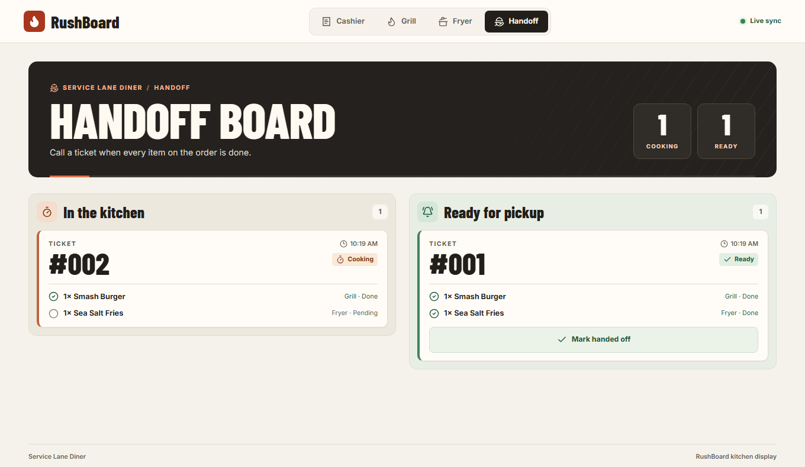

# RushBoard

A kitchen ticket system for the fictional **Service Lane Diner**, inspired by the handoffs between the counter, grill, and fryer during a rush.

**[Try the live demo](https://akaadiarun.github.io/rushboard/)**. Send the burger-and-fries order from Cashier, finish each item on Grill and Fryer, then watch it move to **Ready for pickup** on Handoff. Open the screens in separate tabs to watch them update together.

The GitHub Pages demo stores its tickets in your browser. Run the Docker Compose stack below to try the FastAPI and PostgreSQL implementation, including database-backed retries.



## Quick start

From the repository root, with Docker and the Compose plugin running:

```sh
docker compose up --build
```

| Screen | URL | What to do |
| --- | --- | --- |
| Cashier | [localhost:8080](http://localhost:8080/) | Leave one Smash Burger and one Sea Salt Fries selected. Click **Send to kitchen**. |
| Grill | [localhost:8080/grill](http://localhost:8080/grill) | Confirm only the burger appears for the ticket. Click **Mark done**. |
| Fryer | [localhost:8080/fryer](http://localhost:8080/fryer) | Confirm only the fries appear. Finish these after checking the handoff board. |
| Handoff | [localhost:8080/handoff](http://localhost:8080/handoff) | Watch the ticket stay **Cooking** after the burger, then move to **Ready for pickup** after the fries. Click **Mark handed off** to clear it. |

Keep the four tabs open before sending the order. Each board checks for updates every 1.5 seconds. The app serves [interactive API docs](http://localhost:8080/docs) on the same port.

`docker compose down` stops the app and keeps orders in the PostgreSQL volume. Use `docker compose down -v` only when you want to erase the local demo data. Set `RUSHBOARD_PORT` before starting if port 8080 is in use.

## Architecture

```text
Cashier   Grill   Fryer   Handoff
    React + TypeScript screens
                │
         Same-origin HTTP
                │
   FastAPI  ─── PostgreSQL
```

Docker Compose runs one FastAPI service and PostgreSQL. The Docker build compiles the frontend, then FastAPI serves it alongside the JSON API. On startup, FastAPI initializes the schema and the two menu options. The app binds to localhost for a shared-screen demo on one computer.

- **Routing.** The cashier sends item codes and quantities. FastAPI looks up each item's station from the menu and stores it on the order line in the same transaction as the ticket. Each station reads its own unfinished lines, oldest ticket first. The API also checks station ownership when marking a line done.
- **Readiness.** A station records a completion timestamp on its line. The handoff query calculates readiness from all lines together with `bool_and`. The API checks the same rule before accepting handoff. The boards poll PostgreSQL-backed snapshots, so each screen can recover on its next successful request after a disconnect.
- **Retry safety.** The cashier creates a UUID per submission and saves the key and cart in tab session storage before sending. PostgreSQL enforces a `UNIQUE` constraint on `tickets.idempotency_key`. The winning insert writes the ticket and its lines in one transaction. A competing insert waits for that transaction and, if it loses, reads the original receipt in a new SQL statement. Matching carts get the original ticket number and timestamp. A changed cart with the same key gets `409 Conflict`. [PostgreSQL transaction isolation](https://www.postgresql.org/docs/17/transaction-iso.html)

## Reproduce a duplicate submission

With Compose running, use the same key and body twice. This example uses a Bash-compatible shell, including Git Bash on Windows.

```sh
KEY=$(docker compose exec -T app python -c 'import uuid; print(uuid.uuid4())')
send_ticket() {
  curl -sS -i http://localhost:8080/api/tickets \
    -H "Idempotency-Key: $KEY" \
    -H 'Content-Type: application/json' \
    -d '{"items":{"burger":1,"fries":1}}' "$@"
}
send_ticket -o /dev/null  # Let the server commit, then discard the response.
send_ticket              # HTTP 200 with the original receipt.
```

To see `201 Created` and compare both receipt bodies, run the example with a fresh key and remove `-o /dev/null`. The handoff board shows one ticket from the two submissions.

## Tests

- **API integration.** Routing, rejecting a station's attempt to complete another station's item, readiness in either completion order, retries, invalid orders, and eight concurrent submissions for one key. The concurrency test also checks the ticket and item counts directly in PostgreSQL.
- **Browser.** Playwright opens all four screens at once and checks that they update without reloads as each station finishes. A second test lets the first POST commit, drops the response, reloads the cashier, and checks that retrying returns the same ticket.

GitHub Actions runs both suites on pushes and pull requests. To run the API suite locally, use Python 3.12 and set `TEST_DATABASE_URL` to a PostgreSQL test database where your role can create schemas. Each test uses an isolated schema.

```sh
cd backend
python -m pip install -r requirements-test.txt
python -m pytest -q
```

To run the browser suite, start Compose first, then use Node.js 22:

```sh
cd frontend
npm ci
npx playwright install chromium
npm run test:e2e
```

[Third-party notices for the bundled interface](frontend/public/assets/notices)
